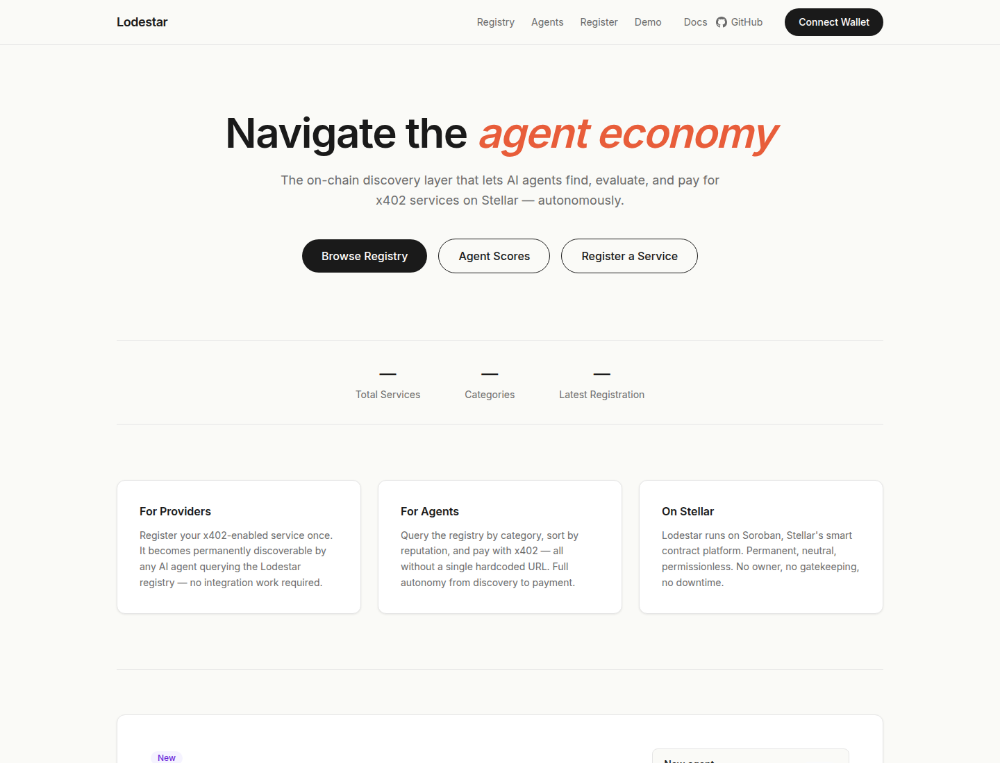
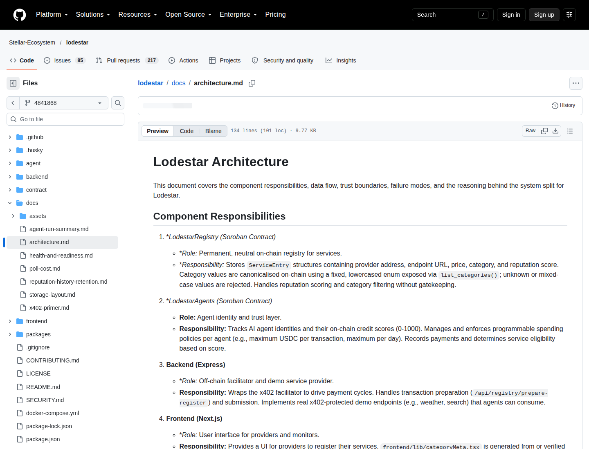
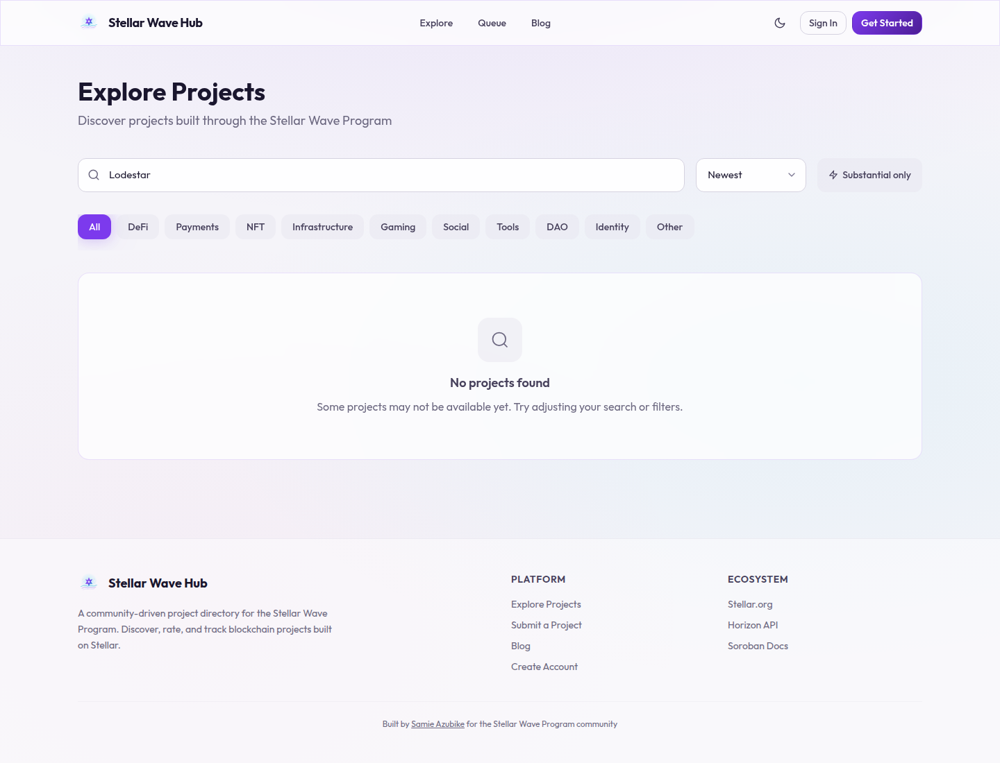
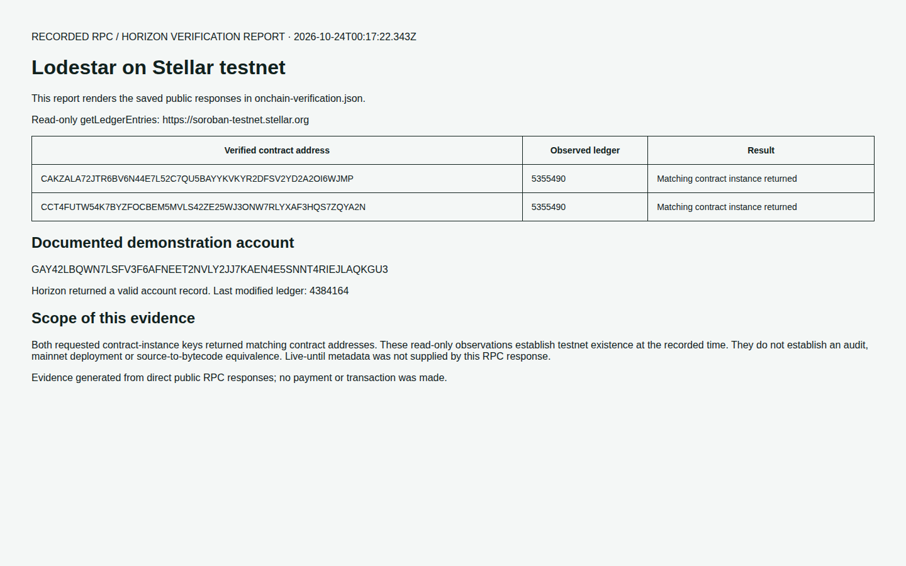

# Lodestar — Stellar Wave project research

Researcher: [TS-mfon](https://github.com/TS-mfon) · 2026-10-24 · [Issue #308](https://github.com/samieazubike/stellar-wave-hub/issues/308)

## Project description

Lodestar is an open-source experiment in discovering and evaluating automated services on Stellar. Payment support alone does not tell a software agent where to find a useful service or whether a provider has a credible track record. Lodestar addresses that gap with a Soroban service registry: providers advertise endpoints, prices and categories, while consumers query the registry instead of embedding every destination in application configuration.

The project separates discovery from agent identity. Its registry contract stores service records and reputation, and its agents contract manages credit scores and spending policies. Source review at commit 4841868a7caa confirms provider authorization during registration, caller authorization for reputation updates, pagination for discovery, and provider authorization for recording agent payments. These checks show how the current source approaches trust; they do not establish an independent audit or prove that deployed contracts use this exact revision.

An Express backend connects the contracts to transaction preparation and the demonstration services. A Next.js interface lets providers register services and lets users inspect the registry and agent leaderboard. Providers sign prepared transactions through their own wallet. A standalone consumer demonstrates discovering an endpoint and accessing a service through the x402 payment flow. This research examined documentation and implementation rather than making a payment or treating a marketing claim as settlement evidence.

Stellar supplies the ledger and Soroban execution environment. On 2026-10-24, direct testnet RPC queries returned contract-instance entries for both published contracts at ledger 5355490. Horizon also returned the documented demonstration account. The recorded response XDR binds each observed instance to its contract address. These are specific existence checks on testnet; they do not establish mainnet deployment, contract feature parity, revenue or production adoption.

The project repository documents participation in the tenth Stellar Wave Program through an application and a subsequent Drips Wave acceptance notification. Before refreshing this research, the complete public Hub catalog contained 36 approved projects and no matching project name, website or repository. Pending submissions are not visible through that catalog.

Lodestar fits the Infrastructure category because it provides discovery and reputation components for other applications. Public GitHub history and open contribution issues provide community evidence, but the sources reviewed do not establish a legal entity or a complete team roster. The README describes the deployment as an early-stage prototype and notes that demo scripts can inflate agent scores with synthetic activity. Consequently, visible leaderboard scores should not be interpreted as independently measured customer reliability. The project is best understood as a testnet research and developer infrastructure prototype with a useful separation of registry, identity and off-chain service access.

## Research method and findings

The public Hub catalog was checked before refreshing the project research. All 1 returned pages were inspected: 36 approved projects, with zero case-insensitive Lodestar matches across names, websites and repository URLs. Catalog entries, pagination and matching fields are preserved in [hub-duplicate-check.json](hub-duplicate-check.json). Pending submissions cannot be checked anonymously.

The source review uses immutable commit **4841868a7caa8f13cd396eb1a482afbbd5664387**. [source-verification.json](source-verification.json) records the retrieved paths, SHA-256 fingerprints and participation evidence. The README's introductory production claim conflicts with its later maturity section; the profile uses the explicit prototype/testnet maturity statement. The architecture document's broad enforcement claims are treated as design intent, while the implementation is the evidence for individual authorization checks.

Registry register_service requires provider authorization. update_reputation requires an authorized caller, and list_services_page limits the records returned in a query. The agents implementation requires provider authorization in record_payment and exposes check_spending_allowed for policy evaluation. The backend routes connect those contract operations to off-chain reads and prepared transactions. A spending-policy check in source is insufficient to prove that every external payment path enforces it, so that stronger claim is excluded.

The README explicitly identifies demonstration seeding that increases scores through synthetic payments. This affects how leaderboard activity should be interpreted. No independent security audit or evidence of production adoption was identified in the reviewed official sources.

## Stellar Wave participation

The repository's [Wave 10 application](https://github.com/Stellar-Ecosystem/lodestar/issues/656#issuecomment-6206714093) identifies the Stellar Wave Program. Its [Drips Wave acceptance notification](https://github.com/Stellar-Ecosystem/lodestar/issues/656#issuecomment-6285637541) confirms an accepted contribution. The source record preserves both timestamps and body fingerprints. This is repository participation evidence, not an inference from the project's name or marketing.

## On-chain verification

Network: Stellar testnet. Method: read-only getLedgerEntries, requesting each address's persistent contract-instance key. Endpoint: https://soroban-testnet.stellar.org.

| Published contract address | Observed ledger |
| --- | --- |
| CAKZALA72JTR6BV6N44E7L52C7QU5BAYYKVKYR2DFSV2YD2A2OI6WJMP | 5355490 |
| CCT4FUTW54K7BYZFOCBEM5MVLS42ZE25WJ3ONW7RLYXAF3HQS7ZQYA2N | 5355490 |

Horizon returned demonstration account **GAY42LBQWN7LSFV3F6AFNEET2NVLY2JJ7KAEN4E5SNNT4RIEJLAQKGU3** from [its account endpoint](https://horizon-testnet.stellar.org/accounts/GAY42LBQWN7LSFV3F6AFNEET2NVLY2JJ7KAEN4E5SNNT4RIEJLAQKGU3). [onchain-verification.json](onchain-verification.json) preserves the account response, contract keys, instance XDR and observation time. Each returned contract address was decoded and checked against its requested address. Live-until metadata was not supplied by this RPC response (the SDK reported zero), so no expiry claim is made. No transaction was signed or broadcast.

These observations prove address existence on testnet at the recorded time. They do not prove source-to-deployment bytecode equivalence, an audit or mainnet availability. Testnet ledger state can expire or reset; recheck before future publication.

## Classification and community

Category: **Infrastructure**. Tags: Soroban, service discovery, agents, reputation, developer tools, Stellar Wave. The registry and identity components serve other applications, which makes infrastructure a better fit than a consumer payment product.

The maintained public repository is under Stellar-Ecosystem. Its README also refers to the original harshita4ever/lodestar repository. Open issues, contributor pull requests and the Wave acceptance show public development activity. This research does not infer company registration, individual employment or a complete team roster from repository ownership.

## Sources

Retrieved on 2026-10-24; source files are pinned to the commit above.

- [README.md](https://github.com/Stellar-Ecosystem/lodestar/blob/4841868a7caa8f13cd396eb1a482afbbd5664387/README.md)
- [docs/architecture.md](https://github.com/Stellar-Ecosystem/lodestar/blob/4841868a7caa8f13cd396eb1a482afbbd5664387/docs/architecture.md)
- [contract/src/lib.rs](https://github.com/Stellar-Ecosystem/lodestar/blob/4841868a7caa8f13cd396eb1a482afbbd5664387/contract/src/lib.rs)
- [contract/agents/src/lib.rs](https://github.com/Stellar-Ecosystem/lodestar/blob/4841868a7caa8f13cd396eb1a482afbbd5664387/contract/agents/src/lib.rs)
- [backend/src/routes/agents.js](https://github.com/Stellar-Ecosystem/lodestar/blob/4841868a7caa8f13cd396eb1a482afbbd5664387/backend/src/routes/agents.js)
- [Live product](https://lodestar-ruddy.vercel.app)
- [Wave application](https://github.com/Stellar-Ecosystem/lodestar/issues/656#issuecomment-6206714093) and [accepted application](https://github.com/Stellar-Ecosystem/lodestar/issues/656#issuecomment-6285637541)
- [Hub public catalog](https://usestellarwavehub.vercel.app/api/projects?limit=50&page=1)
- [Registry explorer](https://stellar.expert/explorer/testnet/contract/CAKZALA72JTR6BV6N44E7L52C7QU5BAYYKVKYR2DFSV2YD2A2OI6WJMP) and [agents explorer](https://stellar.expert/explorer/testnet/contract/CCT4FUTW54K7BYZFOCBEM5MVLS42ZE25WJ3ONW7RLYXAF3HQS7ZQYA2N)
- [Horizon demonstration account](https://horizon-testnet.stellar.org/accounts/GAY42LBQWN7LSFV3F6AFNEET2NVLY2JJ7KAEN4E5SNNT4RIEJLAQKGU3) and saved direct Soroban RPC responses

## Supporting screenshots

Captured public source pages and the rendered on-chain report are included with this profile. The report is labeled as a rendering of the saved RPC/Horizon responses.

[screenshots/manifest.json](screenshots/manifest.json) records each capture URL, date and evidence type.

## Submission materials

[submission.json](submission.json) contains the original 423-word description and the Hub's project fields. Its research_images array is empty until the accompanying screenshots receive public uploaded URLs.

The requester instructed proceeding with the PR without Hub authentication. An authenticated live Hub upload was therefore omitted. This PR supplies the research and editable submission materials; it does not claim a live submission receipt or project ID. Before a later upload, check the current catalog and pending queue again, upload the screenshots, fill research_images, and submit through [Submit a Project](https://usestellarwavehub.vercel.app/submit).
