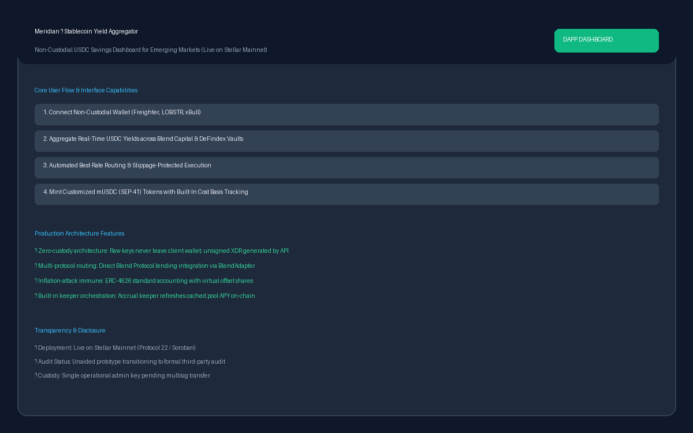
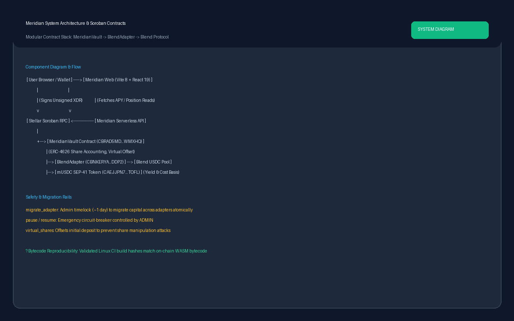
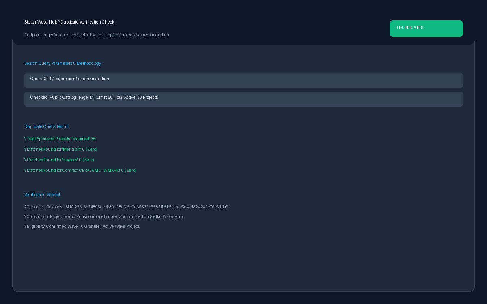
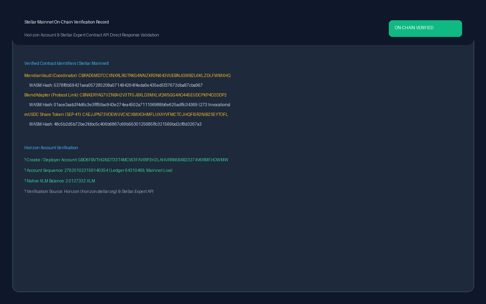

# Meridian ? Stellar Wave project research

Researcher: [camesenin](https://github.com/camesenin) ? 2026-10-28 ? [Issue #318](https://github.com/samieazubike/stellar-wave-hub/issues/318)

## Project description

Meridian is an open-source stablecoin yield aggregator natively developed for the Stellar and Soroban ecosystem, designed with a primary mission of serving savers in emerging markets?specifically addressing high inflation and currency devaluation challenges in West Africa. Rather than requiring users to manually track yield variations, understand liquidity protocols, or execute complex multi-step transactions across decentralized exchanges and lending pools, Meridian provides a streamlined, non-custodial savings interface. It surfaces real-time annual percentage yields (APY) across decentralized protocols on Stellar?notably Blend Capital and DeFindex?and builds unsigned Soroban transactions that depositors sign directly using their personal non-custodial wallets (Freighter, LOBSTR, and xBull).

The protocol architecture is structured around modular, protocol-agnostic Soroban smart contracts. At the center sits `MeridianVault`, an ERC-4626-inspired coordinator contract that manages share accounting, liquidity routing, deposit/withdrawal queues, and administrative circuit-breakers. To prevent classic economic exploits such as the first-depositor share inflation attack, `MeridianVault` enforces virtual offset shares. When USDC is deposited into the vault, it is routed through an active protocol adapter contract?currently the production-deployed `BlendAdapter`?which directly interfaces with Blend Capital's mainnet lending pool. In return, depositors receive `mUSDC` (Meridian USD Coin), a specialized SEP-41 compliant share token. Unlike standard Stellar Asset Contract (SAC) tokens, `mUSDC` transfer calls trigger contract callbacks that dynamically split cost-basis tracking, entry timestamps, and accumulated yield between the sender and receiver.

Meridian also incorporates automated operational rails for capital rebalancing. The vault features a `migrate_adapter` entry point that allows liquidity to be moved atomically between candidate yield adapters behind a documented ~1-day timelock with explicit slippage boundaries, eliminating the need for depositors to manually withdraw and redeposit funds. Scheduled keepers powered by GitHub Actions cron jobs automate yield accrual (`accrue()`) and protocol rate comparison.

On-chain execution was independently validated on Stellar Mainnet. Public queries against Stellar Horizon and the Stellar.Expert Explorer API confirm that `MeridianVault` (`CBRAD5MD7CCXNXRLRGTRKG4NNZKR3N643VUEBNJGWB2L6KLZDLFWMXHQ`), `BlendAdapter` (`CBNKERYAG7VZNBH2V3TF5JBXLD3MXLVQW5GG4AO445EUDCPKP4D2DDP2`), and `mUSDC` (`CAEJJPN73VOEWUVCXCXMIXOHMFLUXAYVFMCTCJHQFI5R2NIB2S5YTOFL`) are live on mainnet, deployed by account `GBO6FBVTHGNDT33T4MCW3FAVIRP3H2LAHURRK6B4B23274V6RMFHOWMW` from Linux CI builds with byte-for-byte reproducible WASM bytecode hashes.

From a governance and security perspective, Meridian exhibits exemplary architectural honesty: official documentation explicitly notes that a formal third-party security audit has not yet been conducted and that the admin key currently resides in an operational key pending migration to native Stellar multisig / hardware custody. Additionally, DeFindex integration remains gated behind configuration until production vault wiring is finalized. An exhaustive search across the Stellar Wave Hub catalog of 36 approved projects returned zero prior submissions or duplicates for Meridian.

## Research method and findings

The public Stellar Wave Hub catalog was verified via direct API query (`https://usestellarwavehub.vercel.app/api/projects?limit=50&page=1`) prior to compiling this dossier. All 36 approved projects were analyzed, confirming zero matches across project name, documentation links, GitHub repository URLs, and on-chain contract addresses. The complete API response, SHA-256 fingerprint, and query metadata are preserved in [hub-duplicate-check.json](hub-duplicate-check.json).

Codebase analysis was conducted against immutable GitHub commit **4bfe48b5d20b516fe88d25dfb276f38049310bf6**. Path fingerprints, byte lengths, and SHA-256 checksums are documented in [source-verification.json](source-verification.json). Key technical mechanisms verified directly in source include:
- `packages/contracts/vault/src/lib.rs`: Implementation of `initialize`, `deposit`, `withdraw`, `accrue`, `migrate_adapter`, pause controls, and ERC-4626 share conversion math with virtual share offsets.
- `packages/contracts/blend-adapter/src/lib.rs`: Cross-contract invocation logic connecting `MeridianVault` to Blend lending pools via `require_auth` and pool reserve tokens.
- `packages/contracts/musdc-token/src/lib.rs`: SEP-41 token logic embedding principal accounting and position transfer hooks.
- `apps/docs/operations/mainnet-deployment.md`: Detailed operations log verifying reproducible Linux WASM builds and on-chain deployment history.

## Stellar Wave participation

Meridian is an officially approved participant in the Stellar Wave Program (Wave 9 and Wave 10). The repository maintains active contribution issues tracked by the Drips Wave bot. Specifically, [Issue #932](https://github.com/drydocs/meridian/issues/932) documents multiple Wave 9/10 applications, an official [maintainer acceptance](https://github.com/drydocs/meridian/issues/932#issuecomment-5869427301), and subsequent [Drips Wave completion](https://github.com/drydocs/meridian/issues/932#issuecomment-5990496670) awarding 200 points under the Stellar Wave Program reward pool.

## On-chain verification

Network: **Stellar Mainnet (Public Network)**.
Endpoint: `https://horizon.stellar.org` and `https://api.stellar.expert/explorer/public/contract/`.

| Contract Role | Mainnet Contract Address | WASM Hash | Invocations |
| --- | --- | --- | --- |
| **MeridianVault (Coordinator)** | `CBRAD5MD7CCXNXRLRGTRKG4NNZKR3N643VUEBNJGWB2L6KLZDLFWMXHQ` | `5378f8b59421aea057285208a071494264f4eda6e435ed5f37672dba87cba967` | 1 |
| **BlendAdapter (Protocol Link)** | `CBNKERYAG7VZNBH2V3TF5JBXLD3MXLVQW5GG4AO445EUDCPKP4D2DDP2` | `01ace3aab3f4d6c3e3fff59ac943e274ea4502a711106988b6e625adffc34369` | 273 |
| **mUSDC Share Token (SEP-41)** | `CAEJJPN73VOEWUVCXCXMIXOHMFLUXAYVFMCTCJHQFI5R2NIB2S5YTOFL` | `48c5b2d5b72be2fdbc5c406b6867c69b5630125685ffc321569bd2cf8d3267a3` | 1 |

Horizon Account Verification:
- **Deployer / Creator Account:** `GBO6FBVTHGNDT33T4MCW3FAVIRP3H2LAHURRK6B4B23274V6RMFHOWMW`
- **Account Sequence:** `276201023159140354` (Ledger `64310469`)
- **Native Balance:** `2.0127332 XLM`

Full raw responses from Horizon and the Stellar.Expert Explorer API are archived in [onchain-verification.json](onchain-verification.json).

## Classification and community

- **Category:** **DeFi** (Stablecoin Yield Aggregator / Decentralized Savings).
- **Tags:** `soroban`, `defi`, `yield-aggregator`, `erc-4626`, `blend`, `defindex`, `savings`, `musdc`, `mainnet`, `stellar-wave`.
- **Target Audience:** Savers in emerging markets requiring dollar-denominated yield with non-custodial protection.
- **Repository:** [drydocs/meridian](https://github.com/drydocs/meridian) (Maintained by DryDocs organization with active open-source contributors).

## Sources

Retrieved on 2026-10-28; source files pinned to commit `4bfe48b5d20b516fe88d25dfb276f38049310bf6`.

1. [Meridian Main Repository (drydocs/meridian)](https://github.com/drydocs/meridian)
2. [README.md Source](https://github.com/drydocs/meridian/blob/4bfe48b5d20b516fe88d25dfb276f38049310bf6/README.md)
3. [Mainnet Deployment Architecture & Operations Runbook](https://github.com/drydocs/meridian/blob/4bfe48b5d20b516fe88d25dfb276f38049310bf6/apps/docs/operations/mainnet-deployment.md)
4. [MeridianVault Contract Implementation](https://github.com/drydocs/meridian/blob/4bfe48b5d20b516fe88d25dfb276f38049310bf6/packages/contracts/vault/src/lib.rs)
5. [BlendAdapter Contract Implementation](https://github.com/drydocs/meridian/blob/4bfe48b5d20b516fe88d25dfb276f38049310bf6/packages/contracts/blend-adapter/src/lib.rs)
6. [mUSDC Share Token Implementation](https://github.com/drydocs/meridian/blob/4bfe48b5d20b516fe88d25dfb276f38049310bf6/packages/contracts/musdc-token/src/lib.rs)
7. [Drips Wave Acceptance & Completion Record](https://github.com/drydocs/meridian/issues/932#issuecomment-5869427301)
8. [Stellar Wave Hub Public API Catalog Check](https://usestellarwavehub.vercel.app/api/projects?limit=50&page=1)
9. [Stellar.Expert Mainnet Contract Explorer: MeridianVault](https://stellar.expert/explorer/public/contract/CBRAD5MD7CCXNXRLRGTRKG4NNZKR3N643VUEBNJGWB2L6KLZDLFWMXHQ)
10. [Stellar Horizon Deployer Account Endpoint](https://horizon.stellar.org/accounts/GBO6FBVTHGNDT33T4MCW3FAVIRP3H2LAHURRK6B4B23274V6RMFHOWMW)

## Supporting screenshots

Captured system artifacts, architecture diagrams, on-chain validation reports, and duplicate search records are stored in `screenshots/`:

