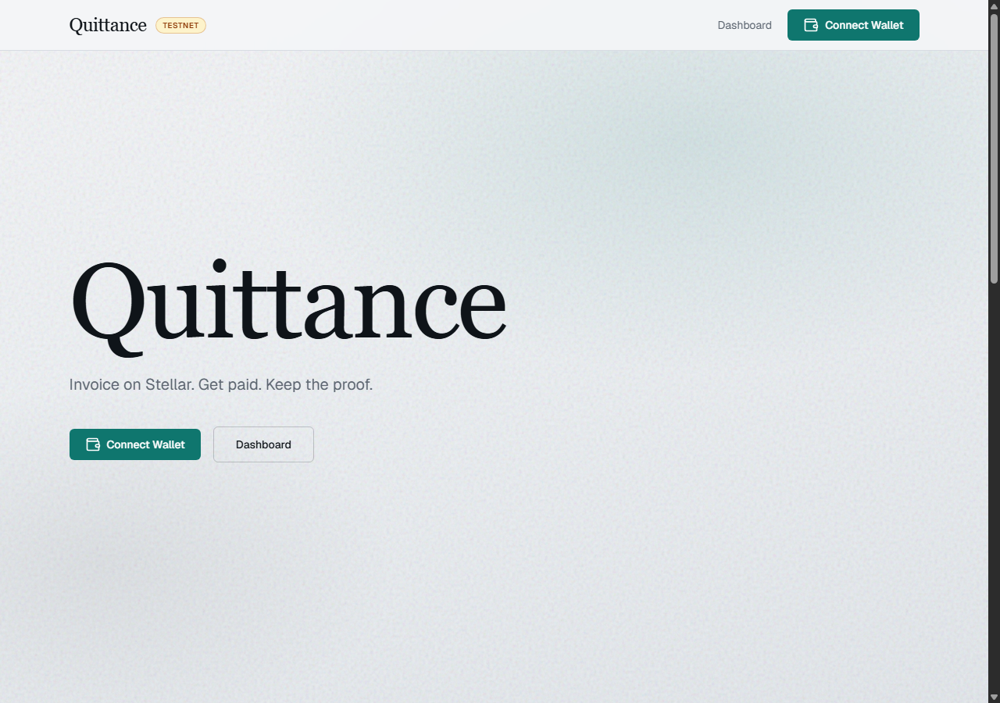
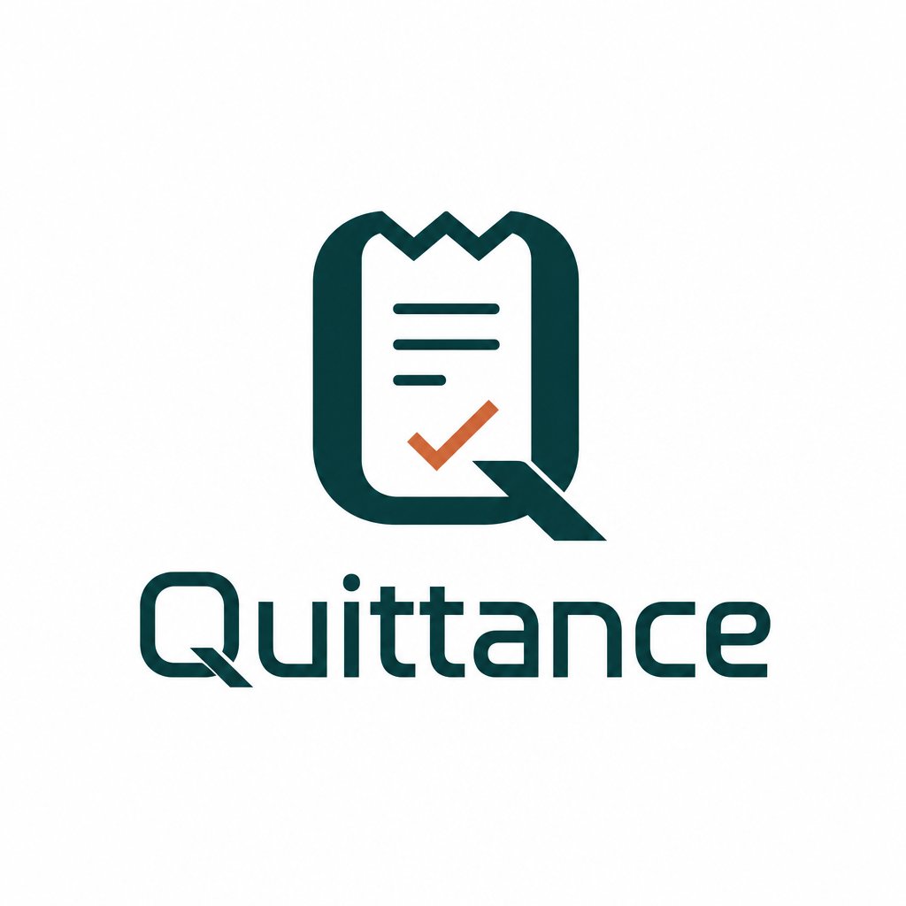

# Quittance — Stellar Wave Research Submission

## Project selected

- Project: Quittance
- Repository: https://github.com/CemAyyildiz/Quittance
- Live application: https://quittance-eosin.vercel.app
- Wave source: https://www.drips.network/wave/stellar/repos
- Category: Payments
- Tags: invoices, payments, freelancers, horizon, freighter, testnet, stellar-wave
- Network: Testnet

## Eligibility and duplicate check

Quittance appears in the GitHub catalog linked from the Stellar Wave Program repository list. A search of the live Stellar Wave Hub API for both “Quittance” and project-like variations returned no existing public project record. The repository is therefore eligible for a first Hub submission rather than a duplicate.

## Original project description

Quittance is a small, focused invoicing application for freelancers and independent service providers who need to request a payment on Stellar and retain evidence after settlement. A seller connects a Freighter wallet, enters the invoice details, and receives a payment link or an SEP-0007-compatible Stellar URI. The client can then pay through a wallet or a conventional browser checkout. Because Quittance uses wallet public keys as product identities, the buyer and seller do not need to create a separate platform account for the basic invoice flow.

The project’s main distinction is proof. Quittance does not treat a successful payment as sufficient; it asks its backend to retrieve the transaction from Horizon and compare the memo, amount, destination account, and asset against the invoice. If the payment matches, the application marks the invoice paid and offers a browser-generated PDF or optional email delivery of the proof. This makes the ledger transaction the settlement record while the app supplies a human-readable invoice and receipt experience.

Quittance is currently an MVP rather than a production treasury system. Its own documentation explicitly describes an in-memory demo server, optional local persistence, and Testnet operation. A deployed Soroban contract is not required for the shipped payment flow: invoice verification is performed with Horizon, while the repository also contains experimental Soroban helper and contract crates. This is an important distinction, because profile language should not imply that payments or invoice storage are already governed by deployed contract code.

## Problem it solves

Freelancers commonly face weak or expensive links between invoice issuance and payment evidence. Bank references are often ambiguous, screenshots are easily disputed, and central invoice platforms may separate the payment record from the client identity. Quittance provides a minimal Stellar-native workflow where the payment URI, memo, amount, destination, and asset can be matched to the transaction returned by Horizon. It aims to produce verifiable evidence without introducing a Google-style login or storing other people’s wallet histories.

## How it uses Stellar

Quittance is built for the Stellar Testnet and uses Freighter for wallet connection and signing. The application creates payment links and SEP-0007 URIs, then uses Horizon to verify the resulting transaction. The invoice stores the seller’s public key dynamically, so a connected wallet becomes the seller identity. The frontend also configures Testnet XLM, USDC, and USDT asset choices. No platform-managed Stellar account is used for basic settlement; the payment is sent directly to the seller wallet.

## Technical approach

The frontend is a Next.js and TypeScript application with Tailwind and Freighter integration. The backend is an Express and TypeScript service with an in-memory MVP option, a fuller Postgres-oriented server path, and a Horizon verification endpoint. The verification logic checks the transaction, payment memo, amount, destination, and asset. QR payloads are generated for a browser URL and an SEP-0007 URI, while a browser print flow creates the downloadable proof. The repository includes Playwright-oriented frontend testing and Rust Soroban helper crates, but its live demo currently relies primarily on Horizon rather than a deployed invoice contract.

## Team and community

Cem Ayyildiz is the repository owner and principal contributor. GitHub contributor data also shows additional community contributors, including Damilorlar, emirykl, BigMick03, Adeyemi-cmd, and michealross. Quittance has public issues and an open-source MIT license. The project invites participants to test its hosted frontend and has an evidence document for reporting testnet transactions and feedback. The repository should be understood as an active MVP team project rather than as a mature, audited payment platform.

## Verified Stellar identifier

The repository explicitly configures this Testnet account as the testnet USDC issuer:

- Stellar account: `GBBD47IF6LWK7P7MDEVSCWR7DPUWV3NY3DTQEVFL4NAT4AQH3ZLLFLA5`
- Horizon verification: https://horizon-testnet.stellar.org/accounts/GBBD47IF6LWK7P7MDEVSCWR7DPUWV3NY3DTQEVFL4NAT4AQH3ZLLFLA5
- Horizon response: valid account, native XLM balance, signers, and asset balances

This identifier is a configured asset issuer account, not a Quittance-owned Soroban contract. Horizon confirms that it exists on Testnet. The project does not publish a verified deployed invoice contract ID; its own EVIDENCE.md explicitly marks a Soroban contract deployment as pending. Profile submissions should not invent a contract address.

## Supporting sources

1. https://github.com/CemAyyildiz/Quittance — source code, README, license, and contributors.
2. https://raw.githubusercontent.com/CemAyyildiz/Quittance/main/README.md — product flow and implementation status.
3. https://raw.githubusercontent.com/CemAyyildiz/Quittance/main/EVIDENCE.md — hosted demo and transparent notes about missing testnet transaction and contract evidence.
4. https://raw.githubusercontent.com/CemAyyildiz/Quittance/main/frontend/lib/assets.ts — Testnet asset configuration.
5. https://quittance-eosin.vercel.app — live hosted Testnet frontend.
6. https://horizon-testnet.stellar.org/accounts/GBBD47IF6LWK7P7MDEVSCWR7DPUWV3NY3DTQEVFL4NAT4AQH3ZLLFLA5 — direct on-chain account verification.
7. https://www.drips.network/wave/stellar/repos — Stellar Wave Program repository catalog.

## Screenshots

- 
- 
